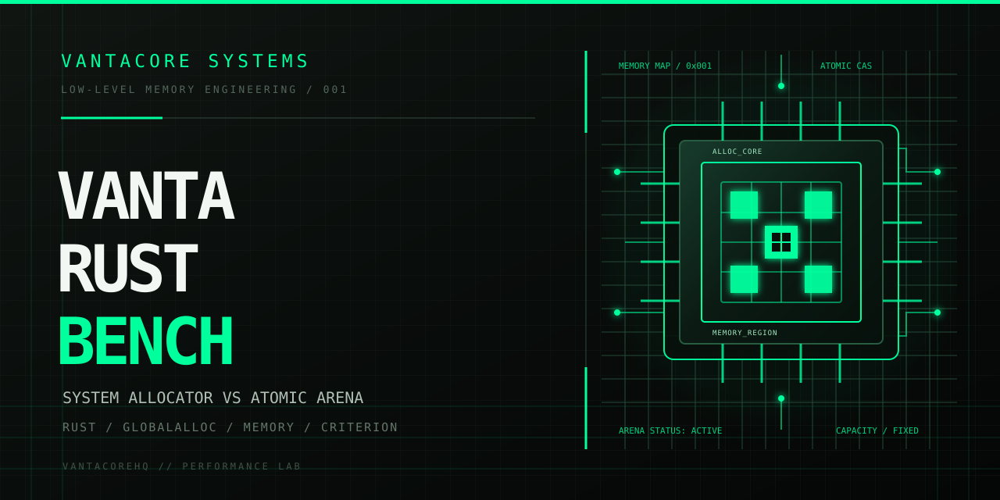

# Vanta Rust Bench

[](https://www.rust-lang.org/)
[](LICENSE)
[](Cargo.toml)

A low-level allocation benchmark comparing Rust's system allocator against a custom fixed-capacity atomic arena. Both implementations use identical allocation layouts and iteration counts. The objective is to measure allocation behavior, examine predictable memory reservation, and understand the trade-offs of arena-based memory management.

## Contents

- [Technical overview](#technical-overview)
- [Why this exists](#why-this-exists)
- [Architecture](#architecture)
- [Methodology](#methodology)
- [Results](#results)
- [Build and run](#build-and-run)
- [Criterion benchmarks](#criterion-benchmarks)
- [Project structure](#project-structure)
- [Limitations](#limitations)
- [Contact](#contact)

## Technical overview

| Component | Implementation |
|---|---|
| Language | Rust 2021 |
| Custom allocator | DeterministicAllocator |
| Allocation strategy | Atomic bump allocation |
| Storage | Fixed-capacity arena |
| Allocation interface | GlobalAlloc |
| Cursor synchronization | AtomicUsize |
| Memory alignment | Layout-aware |
| Benchmark framework | Criterion 0.5 |
| Runtime dependencies | 0 |
| Benchmark execution | Single-threaded |

## Why this exists

Memory allocation is a measurable component of system performance.

In managed runtimes, garbage collection can introduce pauses that contribute to tail latency. In latency-sensitive applications, unpredictable execution time can affect transaction processing, throughput, and operational cost.

General-purpose allocators solve a broad problem: allocation and individual deallocation across different workloads.

An arena allocator follows a narrower contract:

- Memory comes from a bounded region.
- Allocation advances a cursor.
- Alignment is calculated for every request.
- Atomic reservation prevents overlapping concurrent allocations.
- Individual deallocation does not reclaim memory.
- Memory is reclaimed through an explicit arena reset.

This repository implements that contract and compares its allocation path against the system allocator.

The goal is not to prove that one allocator is universally faster. The goal is to make the trade-offs measurable.

## Architecture

The repository contains two allocation implementations.

**System allocator**

Uses `std::alloc::System` for individual allocation and deallocation.

**Deterministic arena**

Uses a fixed-capacity memory region and an atomic cursor to reserve aligned blocks.

Allocation flow:

```text
                Allocation Request
                        |
                        v
                 Layout Validation
                        |
             +----------+----------+
             |                     |
             v                     v
        System Allocator      Atomic Arena
             |                     |
             v                     v
       System.alloc()       Read Cursor
             |                     |
             |               Align Address
             |                     |
             |               Check Capacity
             |                     |
             |               Atomic CAS
             |                     |
             +----------+----------+
                        |
                        v
                  Memory Pointer
                        |
                        v
                 black_box(pointer)
                        |
                        v
                  Deallocation
